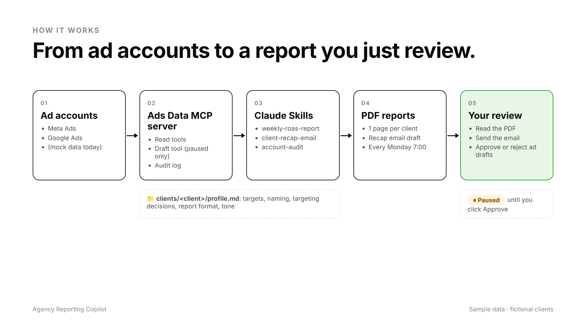

# Agency Reporting Copilot

Claude set up as a trained member of a paid media team. It reads Meta and Google Ads data through a custom **MCP server**, knows each client from a **knowledge profile**, follows three **Claude Skills** for recurring work, produces **weekly one-page PDF reports** on a schedule, and drafts ad changes that stay **paused until a human approves them**.

> Everything here runs on **fictional sample data** (4 made-up clients, 60 days of Meta + Google metrics). No real companies, accounts or people.



## What's inside

| Piece | Where | What it does |
|---|---|---|
| Ads Data MCP server | `packages/mcp-server` | Tools: `list_clients`, `get_campaign_metrics`, `get_mtd_summary`, `find_underperformers`, `audit_account`, `list_draft_ads` (read scope) and `draft_ad_refresh` (draft scope, PAUSED only). Resource `client://<id>/profile`. Every call is written to the audit log. |
| Adapter layer | `packages/core/src/adapters` | `mock` (sample data) today. `google-ads.ts` and `meta.ts` are documented stubs with the field mapping for the real APIs. |
| Client knowledge | `clients/<id>/profile.md` | Account IDs (placeholders), naming convention, targeting decisions, report format, tone. |
| Claude Skills | `skills/` (linked into `.claude/skills`) | `weekly-roas-report`, `client-recap-email`, `account-audit`, each with examples. |
| Weekly job | `npm run weekly` | One PDF + one recap email draft per client in `reports/YYYY-MM-DD/`. Pulls its numbers through the MCP tools. About 4 seconds for 4 clients. |
| Dashboard | `apps/dashboard` (Next.js) | Run reports and watch progress, open PDFs, read recap drafts, Ask questions, view client knowledge, run audits, approve or reject draft ads, audit log. |
| Approval gate | `packages/core/src/drafts.ts` | Drafts are created PAUSED. Only the dashboard's Approve button can set one live. No MCP tool can. |

## Quick start

```bash
npm install
npm test                 # 39 tests: metrics, audit, MCP tools + scopes, approval gate, report job, Ask
npm run weekly           # PDFs + recap emails → reports/<today>/
npm run build && npm start   # dashboard on http://localhost:3000
```

No API key is needed to try it. Without `ANTHROPIC_API_KEY` the app runs in **test mode**: numbers still come from the MCP tools, and the report wording, recap emails and Ask answers come from deterministic templates. Add a key to `.env` to have Claude write them.

Connect Claude Code (already configured in `.mcp.json`) or Claude Desktop and ask *"How did the roofing client do this month?"* See [SETUP.md](SETUP.md).

## Safeguards

- **Paused by default.** `draft_ad_refresh` creates the ad on the platform as PAUSED. The draft API has no status argument, and a test checks that a smuggled `status: "ACTIVE"` is ignored.
- **Scoped tools.** `MCP_SCOPES=read` exposes only reporting tools. The weekly job runs with read scope only. No tool can change a budget, a status or an existing ad.
- **Human approval.** Approve and Reject exist only in the dashboard (password-protected when deployed). Every decision is logged with who made it.
- **Audit log.** Every MCP tool call (who, what, arguments, result), report run and approval goes to SQLite and the `/log` page.
- **Keys in env vars only.** See `.env.example`. Nothing secret is in the repo.

## Sample data: planted problems

The audit finds every one of these, and nothing else (`tests/audit.test.ts`):

| Client | Problem |
|---|---|
| Glowfield Skincare (ecommerce skincare) | Prospecting campaign at ROAS ~0.6 |
| Ridgeline Roofing (roofing lead gen) | Two campaigns that break the naming convention |
| Harbor Law Group (law firm lead gen) | Meta ad set spending ~140% of its daily budget; display campaign with $500+ spend and zero leads |
| Northstar Partners (white-label agency account) | Creative with 0.25% CTR |

Regenerate with `npm run generate:data` (seeded, so the output is identical every time).

## Repo map

```
apps/dashboard/          Next.js dashboard
packages/core/           adapters, metrics, audit rules, SQLite, drafts, report + email writers, PDF
packages/core/prompts/   writing rules shared by the skills and the weekly job
packages/mcp-server/     the Ads Data MCP server (stdio)
packages/agent/          weekly runner + Ask engine (both use the MCP server in-process)
clients/<id>/profile.md  per-client knowledge
skills/                  Claude Skills (SKILL.md + examples)
data/sample/             generated sample data
scripts/                 generate data, run weekly job, render one report, seed drafts
tests/                   vitest (+ tests/e2e with Playwright)
clips/                   demo video clips + MANIFEST.md
```

More: [SETUP.md](SETUP.md) (install, connect Claude, schedule, deploy) · [HANDOFF.md](HANDOFF.md) (plain-English guide for a teammate).
